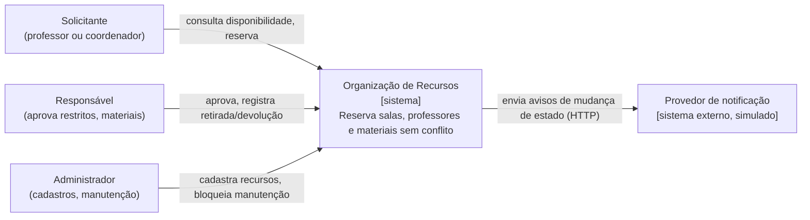
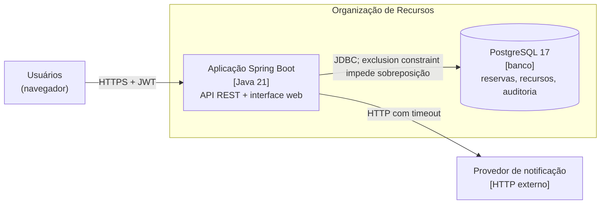
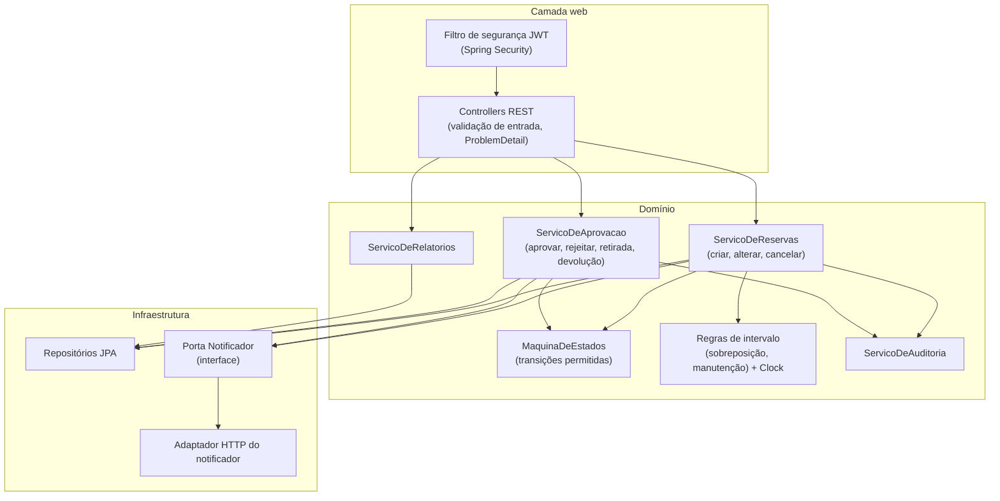
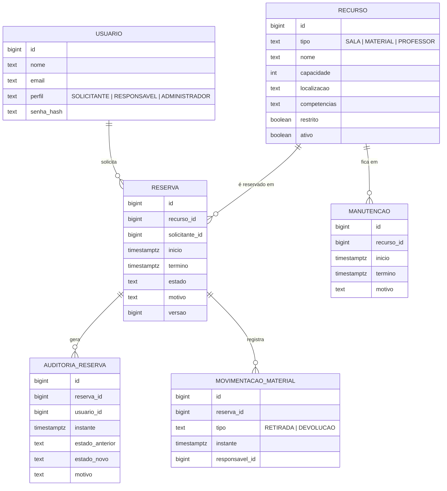
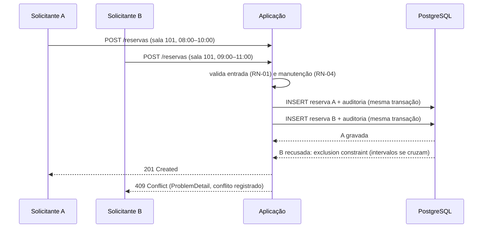

# Organização de Recursos — Arquitetura

> Fontes: [`docs/prd.md`](prd.md) (requisitos e regras), [Especificação do Projeto](https://afonsolelis.github.io/aulas_senac/pages/qualidade2/especificacao-projeto.html), catálogo de táticas em [`docs/taticas-arquiteturais-len-bass.md`](taticas-arquiteturais-len-bass.md) (material da Aula 04).
> Convenção: **Fato** (está nas fontes) · **Suposição** (S-xx, precisa ser confirmada) · **Decisão** (D-xx/ADR). Métricas sem medição ainda são marcadas **validação pendente**.
> Estado em 2026-10-31: arquitetura **proposta**. A seção 12 será preenchida com evidências conforme o código for escrito (Aulas 06 e 07: ciclo ATAM em `docs/avaliacao-arquitetural/`).

## 1. Stack
| Item | Escolha | Origem |
|---|---|---|
| Linguagem | Java 21 (Temurin) | Especificação |
| Framework | Spring Boot 3.5.16 | Especificação ("3.x") + [ADR-001](adr/ADR-001-versao-spring-boot.md) |
| Banco | PostgreSQL 17 | Aulas 03, 08, 10 (PostgreSQL real, sem H2) |
| Migrações | Flyway | D-16 |
| Segurança | Spring Security + JWT | RF-01 + [ADR-003](adr/ADR-003-autenticacao-jwt.md) |
| Build | Maven Wrapper | Aula 03 |
| Interface | **pendente** (Q-01) | — |

## 2. Drivers de negócio
| ID | Driver | Origem |
|---|---|---|
| DR-01 | Nenhum recurso pode ser alocado duas vezes no mesmo horário | Especificação: objetivo + regras críticas |
| DR-02 | Só quem tem o perfil certo executa cada operação | Especificação: RF-01, limitador "falha de autorização" |
| DR-03 | Toda mudança precisa ser rastreável a quem e quando | Especificação: RF-10, regra de auditoria |
| DR-04 | Qualquer avaliador sobe e testa o sistema seguindo só o README | Especificação: limitador "aplicação que não executa"; Aula 14 |
| DR-05 | A consulta de disponibilidade precisa responder rápido no pico (semana de matrícula) | Catálogo Len Bass, seção 8; Aula 10 |

## 3. Visão de contexto (C4 — nível 1)


## 4. Contêineres (C4 — nível 2)

- Um único contêiner de aplicação (D-02 pendente pode acrescentar um contêiner de front-end se a interface for separada).
- O banco é o **ponto único de verdade** para conflito de horário: todas as instâncias da aplicação passam por ele (ADR-002).

## 5. Componentes da aplicação (C4 — nível 3)

- **Por que separar regras de intervalo e máquina de estados:** são as regras críticas mais testadas; isoladas, viram testes de unidade rápidos e com valores-limite.
- **Por que a porta do notificador:** só o adaptador conhece URL, token e formato do provedor; o domínio fala com uma interface. É o padrão do Foot Fanatics na Aula 08 (tática *Tailor Interface + Abstract Data Sources*).

## 6. Modelo de dados (preliminar)

- **Recurso único com `tipo`** (D-07): sala, material e professor são "recursos reserváveis". Assim **uma única exclusion constraint** protege os três tipos contra sobreposição (ADR-002).
- **Professor como recurso:** a agenda do professor entra na mesma regra de sobreposição (RF-05 "inclusive na agenda do professor").
- **Conflitos evitados (RF-12):** registrados em tabela própria de tentativas recusadas — detalhe definido na Fase 5.
- Campos e tipos podem mudar ao implementar; mudanças entram por migração Flyway.

## 7. Fluxos críticos (sequência)
### 7.1 Criar reserva com disputa pelo mesmo recurso

A checagem prévia na aplicação melhora a mensagem, mas **quem decide é o banco**: as duas verificações podem ver "livre" ao mesmo tempo; só a constraint é atômica.

### 7.2 Aprovar recurso restrito
```mermaid
sequenceDiagram
    participant S as Solicitante
    participant R as Responsável
    participant API as Aplicação
    participant DB as PostgreSQL
    participant N as Provedor de notificação
    S->>API: POST /reservas (laboratório restrito)
    API->>DB: reserva SOLICITADA + auditoria
    API-->>S: 201 (SOLICITADA)
    R->>API: POST /reservas/{id}/aprovacao
    API->>API: perfil = Responsável? (RN-05) · não é o próprio solicitante? (RN-06) · transição permitida? (RN-07)
    API->>DB: estado APROVADA + auditoria (mesma transação)
    API-->>R: 200
    API->>N: notifica (timeout 2 s)
    N--xAPI: falha ou demora
    Note over API,N: A aprovação já foi gravada; a falha do provedor não a desfaz (RN-13)
```

## 8. Autenticação e sessão
- Login (`POST /auth/login`) devolve um **JWT** assinado com o perfil do usuário ([ADR-003](adr/ADR-003-autenticacao-jwt.md)).
- Cada requisição envia `Authorization: Bearer <token>`; o filtro do Spring Security valida a assinatura e a expiração.
- Autorização em duas camadas: **por perfil** (rota × perfil, matriz em `docs/seguranca/`) e **por posse** (RN-10: o dono da reserva).
- Senhas com hash **BCrypt**; a chave de assinatura do JWT vem de variável de ambiente, nunca do código.

## 9. Atributos de qualidade e utility tree
Prioridade: (Importância, Dificuldade) em A/M/B. Analisar primeiro os (A, A).

| Atributo (ISO 25010) | Refinamento | Cenário | (I, D) |
|---|---|---|---|
| Confiabilidade | Integridade sob concorrência | CEN-01 — dupla reserva | (A, A) |
| Segurança | Autorização por perfil e posse | CEN-02 — acesso indevido | (A, M) |
| Segurança | Responsabilização | CEN-03 — auditoria com rollback | (A, M) |
| Eficiência de desempenho | Latência no pico | CEN-04 — consulta de disponibilidade | (M, M) |
| Confiabilidade | Tolerância a falha externa | CEN-05 — provedor de notificação fora | (M, B) |
| Manutenibilidade | Testabilidade do tempo | CEN-06 — regra de manutenção na fronteira | (M, B) |

## 10. Cenários de qualidade (seis partes)
| ID | Fonte | Estímulo | Ambiente | Artefato | Resposta | Medida |
|---|---|---|---|---|---|---|
| CEN-01 | 20 solicitantes | pedem a mesma sala no mesmo horário ao mesmo tempo | operação normal, pico | serviço de reservas + banco | exatamente um pedido aceito, os outros recusados com 409 | 1 aceito, 19 × 409, 1 linha no banco, em 5 de 5 execuções |
| CEN-02 | Solicitante autenticado | tenta cancelar a reserva de outro pelo id | operação normal | API de reservas | acesso negado sem revelar a reserva alheia | 100% das tentativas recusadas (403); 0 alterações |
| CEN-03 | Responsável | aprova uma reserva e a gravação falha no meio | falha de banco durante a transação | serviço de aprovação + auditoria | nada é gravado: nem a mudança, nem a auditoria | 0 registros de auditoria órfãos |
| CEN-04 | 50 usuários | consultam disponibilidade simultaneamente | pico, máquina local | API de pesquisa | resposta dentro do limite | p95 ≤ 300 ms, erro < 1% (**validação pendente**) |
| CEN-05 | Provedor de notificação | responde 500 ou passa do timeout | operação normal | adaptador de notificação | reserva confirmada; falha registrada | reserva gravada em 100% dos casos; resposta ≤ 2 s + tempo da reserva (**validação pendente**) |
| CEN-06 | Solicitante | pede reserva que termina exatamente no início da manutenção | operação normal | regra de manutenção | reserva aceita (intervalo semiaberto) | 3 casos de fronteira (−1 s, 0, +1 s) com resultado esperado |

## 11. Análise ATAM preliminar
Táticas pelo catálogo de Len Bass (seção 8 trata deste projeto). Roteiro por decisão: tática · cenário · métrica · custo · teste · risco se faltar.

| Decisão | Tática | Cenário | Custo / trade-off | Teste que evidencia |
|---|---|---|---|---|
| Exclusion constraint + transação (ADR-002) | Transactions + Schedule Resources | CEN-01 | o bloqueio no índice reduz a vazão no pico (**ponto de trade-off**: integridade × throughput) | concorrência 20 → 1 com Testcontainers |
| Matriz perfil × operação + posse (ADR-003) | Authenticate + Authorize Actors | CEN-02 | modelo granular aumenta atrito e complexidade da matriz | teste parametrizado lendo a matriz |
| Auditoria na mesma transação | Audit + Timestamp + Transactions | CEN-03 | volume de dados e dado pessoal (**trade-off: auditoria × LGPD**) | integração com rollback forçado |
| Cancelar muda estado, não apaga | Cancel + Undo | RN-08 | histórico ocupa armazenamento | transições proibidas parametrizadas |
| Porta + adaptador do notificador (ADR-005) | Tailor Interface + Timeout + Degradation | CEN-05 | indireção extra; dublê pode ficar desatualizado | WireMock INT-01..INT-06 |
| `Clock` injetado nas regras | Limit Nondeterminism (testabilidade) | CEN-06 | mais um parâmetro em cada serviço | trinca de limites com `Clock.fixed` |

**Descobertas**
- **Ponto de sensibilidade:** o operador de comparação da sobreposição (`<` × `<=`) decide sozinho se reservas encostadas conflitam (ADR-004).
- **Ponto de trade-off:** um cache de disponibilidade melhoraria CEN-04, mas poderia mostrar livre uma sala já reservada. **Decisão: sem cache** até a medição de desempenho mostrar necessidade.
- **Risco R-01:** se a constraint considerar reservas canceladas, recursos ficam bloqueados para sempre → a constraint vale só para estados que ocupam (SOLICITADA, APROVADA, EM_USO).
- **Risco R-02:** autorização só por perfil, sem posse, permitiria IDOR → posse verificada no serviço (RN-10).
- **Risco R-03:** notificação dentro da transação faria uma falha externa desfazer a reserva → notificar **depois** do commit (RN-13).
- **Não-risco:** queda do provedor de notificação não afeta reservas, porque o envio acontece fora da transação e com timeout.
- **Tema de risco:** todas as regras críticas dependem de tempo — por isso `Clock` injetado em todas.

## 12. Matriz requisito → decisão → componente → evidência
| Requisito | Decisão / ADR | Componente | Evidência de verificação |
|---|---|---|---|
| RF-06 / RN-03 | ADR-002 | constraint no banco + ServicoDeReservas | teste de concorrência (Fase 3) — *pendente* |
| RF-05 / RN-02 | ADR-002, ADR-004 | Regras de intervalo + constraint | testes de limite (Fase 3) — *pendente* |
| RF-01 / RN-10 | ADR-003 | filtro JWT + matriz de autorização | teste parametrizado (Fase 4) — *pendente* |
| RF-10 / RN-09 | auditoria na mesma transação | ServicoDeAuditoria | integração com rollback (Fase 5) — *pendente* |
| RF-11 / RN-13 | ADR-005 | Porta Notificador + adaptador HTTP | WireMock INT-01..06 (Fase 5) — *pendente* |
| RNF-12 | ADR-001, `compose.yaml` | build e README | run do CI + clone limpo — [run 41207988750](https://github.com/guilhermevianacloud/organizacao-recursos/actions/runs/41207988750) |

## 13. Suposições, perguntas e riscos aceitos
- **S-01:** um único contêiner de aplicação basta para o volume de uma instituição de ensino (sem medição ainda).
- **S-02:** o provedor de notificação aceita uma chamada HTTP JSON simples; não há provedor real (RF-11 permite simulação).
- **Q-05 (PRD):** a restrição do cron diário de treino de ML, presente nos prompts da Aula 04, é do case Foot Fanatics; **não foi incorporada**. Confirmar com o professor.
- **Riscos aceitos:** nenhum até o momento.

## 14. Decisões (ADR)
- [ADR-001 — Versão do Spring Boot](adr/ADR-001-versao-spring-boot.md)
- [ADR-002 — Proteção contra dupla reserva no banco](adr/ADR-002-protecao-dupla-reserva.md)
- [ADR-003 — Autenticação com JWT](adr/ADR-003-autenticacao-jwt.md)
- [ADR-004 — Intervalos semiabertos](adr/ADR-004-intervalos-semiabertos.md)
- [ADR-005 — Notificação por porta e adaptador HTTP](adr/ADR-005-notificacao-porta-adaptador.md)
